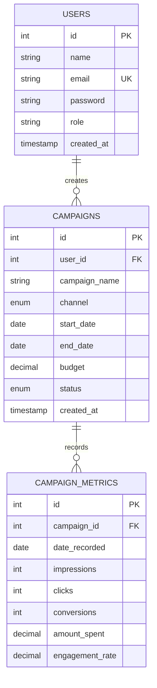

# 📊 Digital Marketing Campaign Tracker
> A full-stack web application designed for marketers and administrators to plan, manage, track, and evaluate digital marketing campaigns across multiple channels with interactive visual analytics.

---

## 🚀 Tech Stack

- **Frontend**: HTML5, CSS3, JavaScript (ES6+), [Bootstrap 5.3.3](https://getbootstrap.com/), [Bootstrap Icons 1.11.3](https://icons.getbootstrap.com/), [Chart.js 4.x](https://www.chartjs.org/)
- **Backend**: PHP 8.x (Structured procedural / modular with reusable includes and helper functions)
- **Database**: MySQL 8.x / MariaDB (Prepared statements using PHP Data Objects - PDO)
- **Web Server**: Apache (100% compatible with XAMPP, WAMP, MAMP, or PHP CLI built-in server)

---

## 📁 File & Directory Structure

```text
digital-marketing-tracker/
├── assets/
│   ├── css/
│   │   └── custom.css             # SaaS layout styling, cards, status badges, responsive drawer
│   └── js/
│       └── custom.js              # Live CTR/CVR calculation, modal population, form validation
├── includes/
│   ├── db_connect.php             # PDO connection singleton & global utility functions
│   ├── auth_check.php             # Session verification & route protection middleware
│   ├── header.php                 # Global HTML header, CDN imports, top navbar & flash alerts
│   ├── sidebar.php                # Responsive sidebar navigation with active route highlights
│   └── footer.php                 # Global footer layout & JS script imports
├── index.php                      # Main Dashboard (KPI cards, spend bar chart, channel pie chart)
├── login.php                      # Authentication login with demo credentials auto-fill
├── register.php                   # User registration with password hashing (bcrypt)
├── logout.php                     # Session destruction and flash logout notification
├── campaigns.php                  # Campaign CRUD: List all campaigns with search & filters
├── add_campaign.php               # Campaign CRUD: Create new campaign form
├── edit_campaign.php              # Campaign CRUD: Update existing campaign form
├── delete_campaign.php            # Campaign CRUD: Delete handler with cascade safety
├── campaign_detail.php            # Single campaign view, aggregate metrics, and Chart.js trend line
├── add_metrics.php                # Log periodic impressions, clicks, conversions, and ad spend
├── reports.php                    # Filterable performance reports with conversion-to-spend ratios
├── export_csv.php                 # Server-side CSV file download generator
├── database.sql                   # Complete SQL schema and realistic seed data
└── README.md                      # Comprehensive documentation & setup instructions
```

---

## 🗄️ Database Architecture

The application utilizes MySQL with foreign keys and cascade integrity:



### Supported Enumerations
- **Channels**: `Social Media`, `Email`, `PPC`, `SEO`, `Display`
- **Statuses**: `Active`, `Paused`, `Completed`

---

## ⚙️ Step-by-Step Installation & Setup (XAMPP / WAMP)

### 1. Start Web & Database Servers
1. Open your **XAMPP Control Panel** (or WAMP).
2. Click **Start** for both **Apache** and **MySQL**.

---

### 2. Import Database Schema & Sample Data
You can import the database using either **phpMyAdmin** (browser GUI) or the **MySQL CLI**.

#### Option A: Using phpMyAdmin (Recommended for Beginners)
1. Open your browser and navigate to: `http://localhost/phpmyadmin/`
2. Click on the **Import** tab in the top menu.
3. Click **Choose File** and browse to `database.sql` inside the project folder:
   ```text
   C:\Users\hulip\.gemini\antigravity\scratch\digital-marketing-tracker\database.sql
   ```
4. Scroll to the bottom and click **Import** (or **Go**).
5. The `digital_marketing_db` database and all 3 tables (`users`, `campaigns`, `campaign_metrics`) will be created and populated with sample data.

#### Option B: Using Command Prompt / PowerShell
```powershell
& "C:\xampp\mysql\bin\mysql.exe" -u root < "C:\Users\hulip\.gemini\antigravity\scratch\digital-marketing-tracker\database.sql"
```

---

### 3. Deploy the Project to Apache

#### In XAMPP:
Copy or move the `digital-marketing-tracker` directory into the XAMPP web root:
```powershell
Copy-Item -Path "C:\Users\hulip\.gemini\antigravity\scratch\digital-marketing-tracker" -Destination "C:\xampp\htdocs\digital-marketing-tracker" -Recurse
```
*(Alternatively, create a directory junction/symlink from `htdocs` to the project folder).*

#### In WAMP:
Copy the directory into `C:\wamp64\www\digital-marketing-tracker`.

---

### 4. Database Connection Settings
If your MySQL setup uses the standard default XAMPP credentials (user: `root`, empty password), **no changes are needed**.

If you have a custom MySQL root password or custom port, edit [includes/db_connect.php](file:///C:/Users/hulip/.gemini/antigravity/scratch/digital-marketing-tracker/includes/db_connect.php):
```php
define('DB_HOST', 'localhost');
define('DB_NAME', 'digital_marketing_db');
define('DB_USER', 'root');
define('DB_PASS', 'your_password_here'); // leave blank '' for standard XAMPP
```

---

### 5. Launch the Application
Open your web browser and visit:
```text
http://localhost/digital-marketing-tracker/
```

---

## 🔑 Default Login Credentials

The sample seed data includes two pre-configured accounts:

| Role | Email Address | Password | Description |
| :--- | :--- | :--- | :--- |
| **Administrator** | `admin@tracker.com` | `password123` | Full system access |
| **Lead Marketer** | `alex@marketing.com` | `password123` | Creator of the sample campaigns |

*(The login screen also provides an **"Auto-fill"** helper button to sign in with one click during testing).*

---

## 🎯 Key Application Features

### 1. Authentication & Security
- Secure registration with client and server validations.
- Password hashing using PHP's native `password_hash($password, PASSWORD_DEFAULT)` (bcrypt).
- Session fixation protection via `session_regenerate_id(true)`.
- SQL injection prevention through **PDO prepared statements** across all queries.
- XSS prevention using `htmlspecialchars()` on all dynamic outputs.
- Route protection middleware (`auth_check.php`) redirecting unauthenticated users to `login.php`.

### 2. Interactive Dashboard (`index.php`)
- **Summary Cards**: Total Campaigns, Active Campaigns, Total Budget, Total Spend.
- **Audience KPIs**: Total Impressions, Total Clicks, Total Conversions, Overall CTR.
- **Budget vs. Actual Spend Chart**: Multi-bar Chart.js visualizer comparing allocated budget against actual campaign spend.
- **Channel Distribution Chart**: Doughnut Chart.js visualizer showcasing campaign allocation across channels.
- **Recent Campaigns Table**: Shows recent activity with real-time budget utilization progress bars and quick actions.

### 3. Campaign CRUD Operations
- **List All (`campaigns.php`)**: Responsive data table with live in-table search and server-side filtering by channel and status.
- **Add Campaign (`add_campaign.php`)**: Form with date timeline validation (`end_date >= start_date`) and budget constraints.
- **Edit Campaign (`edit_campaign.php`)**: Pre-populated update form for ongoing campaigns.
- **Delete Campaign (`delete_campaign.php`)**: Confirmation modal with cascade deletion of related metrics.
- **Campaign Details (`campaign_detail.php`)**: Single campaign breakdown with budget consumption progress, CPC, CPA, Chart.js line graph of performance over time, and history table.

### 4. Metrics Tracking (`add_metrics.php`)
- Record daily/weekly impressions, clicks, conversions, ad spend, and engagement rates.
- **Real-Time Live Calculator**: Automatically calculates CTR (`clicks / impressions * 100`) and Conversion Rate (`conversions / clicks * 100`) as the user types numbers into the form before submitting.

### 5. Reporting & CSV Export
- **Reports Page (`reports.php`)**: Filterable by marketing channel, status, and custom start/end date ranges.
- Computes aggregated spend, conversions, and conversions-per-₹100-spend.
- Summary footer with aggregate totals and average conversion rates.
- **CSV Export (`export_csv.php`)**: One-click download of the active filtered dataset formatted as clean CSV with UTF-8 BOM encoding for Microsoft Excel compatibility.

---

## 🧪 Evaluation Checklist for Academic Assessment

- [x] Clean, well-commented code throughout all PHP, SQL, and JS files.
- [x] Responsive layout utilizing Bootstrap 5 grid, cards, badges, and modals.
- [x] Chart.js integrated via CDN for bar, doughnut, and trend line charts.
- [x] Dynamic calculation of CTR and Conversion Rate on frontend and backend.
- [x] Prepared statements used across 100% of database interactions.
- [x] CSV export functionality with parameter filtering.
- [x] Pre-populated `database.sql` with 6 realistic campaigns across all channels.
